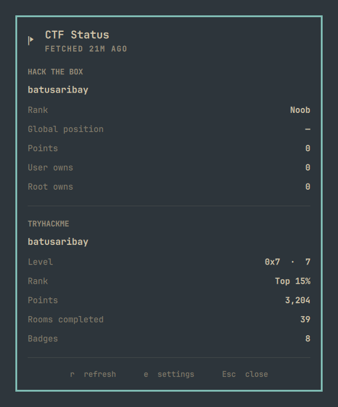

# CTF Status

Hack The Box, TryHackMe and CyLab Academy account status in Omarchy bar widget.



## Why

Tracking CTF progress means checking several sites that bury the numbers you
actually care about. This widget puts them at a glance — HTB rank, global
position, points and owns; your THM level, rank, points, rooms and badges; and
your CyLab solved count and difficulty breakdown — with a single flag glyph in
the bar so you can see your progress without opening anything.

It needs no tokens or logins: point it at your public profiles and you're done.
And it stays out of the way — it only fetches when you ask, so nothing runs in
the background.

## How it works

- It's a bar-widget plugin loaded by `omarchy-shell` from `Panel.qml`.
- It fetches once at startup (served from cache while still fresh) and otherwise
  only on demand, via the `r` key or the `refresh` IPC command. Opening the panel
  never fetches.
- `ctf-fetch.sh` fetches every provider over HTTPS with `curl` pinned to
  `--proto '=https' --proto-redir '=https' --tlsv1.2`:
  - **Hack The Box** — `GET /api/v4/profile/<id>` (no token). Only works once
    **Public profile** is enabled in your HTB Labs settings — the toggle on the
    profile page alone isn't enough.
  - **TryHackMe** — `GET /api/v2/public-profile?username=<name>`. If the site
    serves its anti-bot checkpoint instead, the script retries through a headless
    Chromium (persistent profile in `~/.cache/omarchy-ctfstatus/thm-chrome`), so
    later fetches reuse the cookie. Override with `CTFSTATUS_THM_BROWSER`.
  - **CyLab Academy** (the successor to picoCTF) — `GET /api/users/<name>/` for the
    profile and `GET /api/users/<id>/gym_stats/` for the challenge breakdown (no
    token). Needs a public profile.
- Each result is normalized with `jq` into `~/.cache/omarchy-ctfstatus/status.json`.
  If one provider fails, its cached values are shown as stale while the other
  still refreshes.
- `Model.js` sanitizes every value before rendering — plain text, length-capped,
  numbers coerced and bounded.

## Installation

**Requirements:** an [Omarchy](https://omarchy.org) install with an internet
connection. The fetch helper uses `curl` and `jq`; Chromium is only needed when
TryHackMe's anti-bot checkpoint appears.

```bash
omarchy plugin add https://github.com/batusaribay/omarchy-ctfstatus --enable
```

To remove (including the cache):

```bash
omarchy plugin remove batusaribay.ctfstatus
rm -rf "$HOME/.cache/omarchy-ctfstatus"
```

## License

This project is licensed under the [MIT License](LICENSE).
